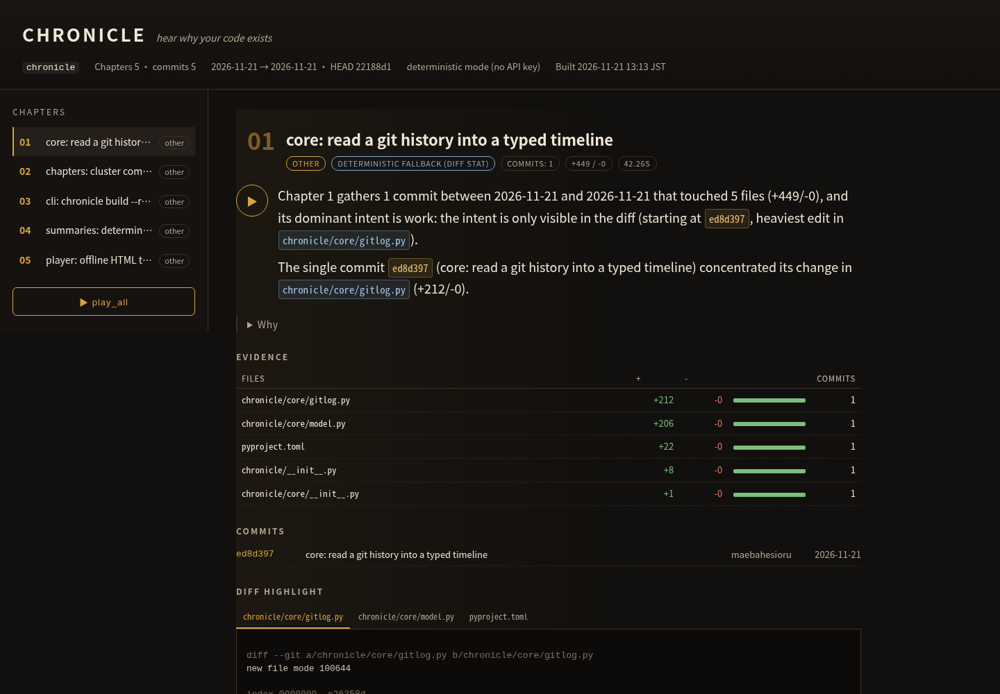

# Chronicle — hear why your code exists

[](https://github.com/maebahesioru/chronicle/actions/workflows/ci.yml)
[](https://maebahesioru.github.io/chronicle/)
[](https://youtu.be/lbwVv5hgjLc)
[](LICENSE)

**A git log tells you what changed. Chronicle tells you why it exists — out loud, with receipts.**

Chronicle reads a local git repository, clusters commits into chapters, writes a two-sentence
"why" for each chapter, narrates it, and ships one offline HTML folder. Its differentiator is a
hard **citation contract**: every sentence that reaches the player must cite a real commit SHA,
a file path from that chapter, or an issue number found in the commit message. A sentence that
cannot be verified is rejected, repaired once, and then dropped — never shipped.

No API key? The deterministic diff-stat summarizer runs instead, with the same citation gate.



- **Live demo (GitHub Pages):** https://maebahesioru.github.io/chronicle/
- **2-minute video:** https://youtu.be/lbwVv5hgjLc
- **Built for:** GenHacks 2026. All code in this repository was written for this event.

## Why this exists

Every team inherits code whose reasons are missing. `git blame` names the commit, but not the
constraint, the bug, or the trade-off behind it. Release notes list tickets; they do not explain
why the ticket mattered. New maintainers, reviewers, and future-you pay for that gap in
re-onboarding time.

Chronicle takes the artifacts that already exist — commits, changed files, diff stats, issue
references — and turns them into a short, listenable tour. It does not invent a narrative and ask
you to trust it. Every claim is pinned to evidence you can click. That is the whole product:
**narration you can audit.**

## What it does

1. Reads `git log` (subject, body, author date, files, numstat, diff excerpts).
2. Clusters commits into chapters: conventional-commit type/scope first, file-set Jaccard
   similarity for everything else, with a per-chapter commit cap.
3. Writes exactly two sentences per chapter, in English or Japanese, using an optional
   OpenAI-compatible LLM or a deterministic diff-stat fallback.
4. Enforces the citation contract on each sentence: inspect → repair once → drop → deterministic
   backfill. The build report records every dropped sentence and why.
5. Synthesizes MP3 narration with edge-tts; on failure it writes real silence and keeps going.
6. Emits a single offline folder: inline CSS/JS, no CDN, no fonts, no network calls at view time.
7. Shows the evidence: chapters, audio player, citation chips, commit table, per-file diff stats,
   and highlighted diff excerpts.

## Quick start (3 commands)

Requires Python 3.10+ and `git`. No runtime Python dependencies; edge-tts is optional.

```bash
python3 -m venv .venv && ./.venv/bin/pip install -e .
./.venv/bin/chronicle build --repo . --out chronicle-out --lang en
xdg-open chronicle-out/index.html   # macOS: open, Windows: start
```

Then open `chronicle-out/index.html`. It works from `file://`, from a USB stick, or zipped
into a release.

Prefer no install? Run the module directly:

```bash
./.venv/bin/python -m chronicle build --repo /path/to/repo --out /tmp/book --lang ja
```

Fully offline, text only:

```bash
./.venv/bin/python -m chronicle build --repo . --out /tmp/book --no-llm --no-audio
```

Release mode — narrate only what changed since a tag:

```bash
./.venv/bin/python -m chronicle build --repo . --since v1.2.0 --out release/
```

## How it works

```text
  git repository
        |
        v
  core/gitlog.py --- commits, files, numstat, issue refs, diff excerpts
        |
        v
  core/cluster.py -- chapters (conventional type/scope, else Jaccard merge)
        |
        v
  summarize.py ----- exactly two sentences per chapter
     /        \
    v          v
 deterministic  llm.py (OpenAI-compatible /chat/completions)
    \          /
     v        v
  core/cite.py ---- citation contract: inspect -> repair -> drop -> backfill
        |
        v
  audio.py --------- edge-tts MP3, real silent WAV fallback
        |
        v
  html.py ---------- index.html (inline CSS/JS) + audio/ + chronicle.json
```

Each stage is a small standard-library module. `build.py` wires them together and writes a
JSON payload; `html.py` renders that payload without a template engine or network access.

## The citation contract

A sentence is allowed into the player only if it carries at least one **known** citation:

| Citation | Accepted form | Must match |
| --- | --- | --- |
| Commit SHA | 7–40 hex chars | a commit in this chapter; all-digit strings are rejected so dates/versions are not mistaken for SHAs |
| File path | path with an extension | a file touched by this chapter |
| Issue reference | `#123` | an issue number present in a chapter commit message |

Outcomes:

- `no-citation` — the sentence carries nothing verifiable → dropped.
- `unknown-citation` — it cites `deadbeef` or `src/imaginary.py` → dropped.
- Repair — the summarizer gets one chance to rewrite the rejected sentence with real evidence.
- Backfill — if fewer than two sentences survive, deterministic diff-stat sentences fill the gap.
  A chapter is never empty, and never uncited.

Example of a shipped deterministic sentence:

```text
Chapter 2 gathers 3 commits between 2026-11-21 and 2026-11-22 that touched
src/core/cite.py (+120/-8), and its dominant intent is fix: validator rejects
unknown citations (starting at 4f2a9c1).
```

In the player, citations are chips. A SHA scrolls to its commit, a path to its file row, an issue
to the evidence block. The build report exposes `dropped` and the reason for every rejection.

Try the gate yourself:

```bash
./.venv/bin/python examples/validator_demo.py
```

## Determinism

Given the same commits, chapter splitting, summaries, citations and the HTML structure are
deterministic. Two things legitimately differ between runs:

- `meta.generated` / the "built" label (wall-clock timestamp);
- narration bytes, because TTS depends on the voice service and local encoder.

The demo artifacts were built with the deterministic engine (no API key), which is why the
public demo can be reproduced offline. The LLM path is covered by tests with a fake client;
it is not used for the published demo.

## Repository layout

```text
chronicle/
  chronicle/
    core/gitlog.py      git parsing: commits, files, numstat, excerpts
    core/cluster.py     chapter clustering
    core/cite.py        citation parsing and the enforcement gate
    core/model.py       typed payload objects
    summarize.py        deterministic + LLM summarizers
    llm.py              OpenAI-compatible client
    audio.py            edge-tts with silent fallback
    html.py             offline player renderer
    build.py            pipeline wiring and build report
    cli.py              build / doctor
    i18n.py             English and Japanese copy
  tests/                26 tests
  demo/                 this repo narrated in English, with audio
  demo-ja/              the same story in Japanese, with audio
  docs/                 Devpost text, demo script, verification log, screenshot
  examples/             validator_demo.py
```

## CLI

```text
chronicle build --repo PATH [--since REF] [--out DIR] [--lang ja|en]
                [--similarity 0.34] [--max-commits 8]
                [--no-audio] [--no-llm] [--json] [-q]
chronicle doctor
```

`doctor` reports Python, git, ffprobe, edge-tts and the selected LLM backend, so a failed demo
is diagnosable in one command.

## LLM backend

Chronicle speaks the OpenAI chat-completions shape and nothing else:

```bash
export CHRONICLE_LLM=openai-compat
export OPENAI_BASE_URL=http://127.0.0.1:8795/v1
export OPENAI_API_KEY=dummy
export CHRONICLE_MODEL=gpt-4o-mini        # optional
./.venv/bin/chronicle build --repo . --out chronicle-out
```

Without `OPENAI_API_KEY` the backend is `none` and the deterministic engine is selected
automatically. LLM/network errors are recorded per chapter and never abort the build; the
deterministic sentences remain the floor.

## Audio

Narration uses edge-tts (`ja-JP-NanamiNeural`, `en-US-AriaNeural`). If synthesis is missing,
offline, or rate-limited, `audio.py` writes a valid silent WAV of a sensible duration. The text
is always present, so the player still completes; no broken audio reference is emitted.

## Tests and CI

```bash
./.venv/bin/python -m pytest -q     # 26 passed
```

The suite covers: citation parsing; the enforcement gate (no citation and unknown citation are
always dropped); deterministic clustering and similarity merging; `--since` filtering; diff
excerpts; and an end-to-end build asserting zero external `http(s)://` references in the HTML
and that every shipped sentence passes the contract. GitHub Actions runs the suite on Python
3.10, 3.11 and 3.12 for every push and pull request.

## Demo artifacts

- `demo/` — this repository narrated in English: 5 chapters, 5 MP3 tracks, 0 dropped
  sentences, 0 external HTTP references.
- `demo-ja/` — the same history in Japanese: 5 chapters, 5 MP3 tracks.

Open either `index.html` directly; the folders make no network requests. The published copy is
on GitHub Pages (deployed from `demo/`).

## Design notes

- **Deterministic first, model second.** The fallback is not a stub: it produces the same
  two-sentence shape from real diff stats and real SHAs.
- **The validator owns the truth, not the prompt.** A model cannot talk its way past an unknown
  SHA or a path that was never touched.
- **Zero runtime dependencies** outside the standard library; edge-tts is optional.
- **One folder, no server.** The player can be zipped, emailed, or attached to a release.

## Honest limits

- Local git only. Chronicle does not call the GitHub API or read issues from a tracker; issue
  citations come from `#N` references in commit messages.
- Conventional commits produce the cleanest chapters; messy histories fall back to file overlap.
- Summaries explain a chapter from its diff stats and messages. They are not a substitute for a
  design document, and the deterministic mode is intentionally terse.
- The public demo uses the deterministic engine. LLM output quality is therefore not demonstrated
  by the hosted artifact; the integration is tested with a fake client.

## License

MIT — see [LICENSE](LICENSE).
